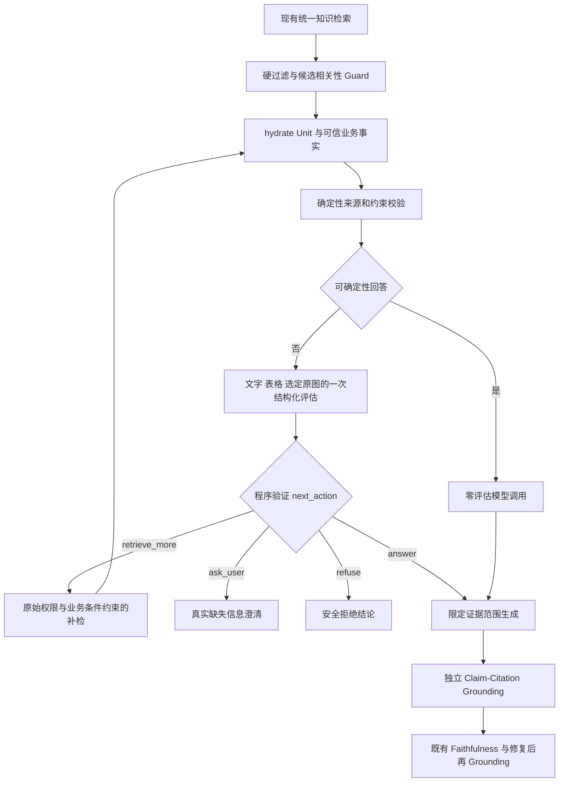

# Unified Multimodal Evidence-Driven Adaptive RAG

实施日期：2026-11-24。基线：最新 main `1d57ff4`。工作分支：`codex/unified-evidence`。

[源码与面试说明](unified-evidence-call-chains.md) · [实际 Schema](unified-evidence-schema.json) · [验证记录](unified-evidence-validation.json) · [合成对照结果](unified-evidence-benchmark.json)

## 1. 本轮完成内容

本轮保留 KnowledgeUnit、BM25/Text Dense/Visual、Unit RRF、SKU 聚合及原 LangGraph 拓扑。重构对象是知识召回之后的证据决策，以及生成式模型的调用基础设施。

售前搜索、详情、比较在生成回答之前接入 run_evidence_workflow()；售后政策和授权订单事实也使用该执行器。成熟的 Policy Follow-up 循环迁入 evidence_workflow.py，旧 policy_followup.py 只保留协议适配。没有两套独立的评估、补检、停止状态机。

旧售前以 Query Guard/视觉核验判断候选，售后单独先核验图像再做政策评估；文本与视觉模型使用不同客户端。现在使用请求级 Bundle、严格通用 Assessment、领域规则和一个生成式 HTTP Gateway。legacy 模式保留旧决策协议和模型配置语义，支持回滚。



## 2. EvidenceBundle 与 Assessment

完整 Pydantic JSON Schema 位于 unified-evidence-schema.json，实际类在 evidence_schema.py。所有协议禁止额外字段并启用 strict 校验。

EvidenceBundle 保存 task_id、完整问题、允许的领域、EvidenceRef、由可信代码声明的必要 Aspect、业务上下文、硬约束和补检范围。它是请求级对象，不写入 KnowledgeUnit 或新的知识表。

EvidenceRef 保留 evidence_id、kind、domain、target_id、真实 unit_id/asset_id/element_id/source_id、版本、权威性、原文、结构化事实、位置、校验标志和快照指纹。政策证据还带有明确的 PolicyApplicability：文档/政策身份、主题、平台、司法辖区、受众、类目、生效区间、状态和优先级。

四种来源分别处理：

- KnowledgeUnit：经 hydrate(unit_id) 取得正文、表格或图像原始来源。
- Catalog：从当前商品库读取字段；不把模型描述写回商品属性。
- Order：授权 SQL/订单工具事实，unit_id 必须为空，不构造虚假知识单元。
- VisualObservation：一次多模态评估返回的请求级观察，与原 Unit、Asset、目标、版本和快照绑定。观察保存在评估结果中，作为原图证据的核验记录，不反写资产 Caption、商品字段或政策条款。

Assessment 包含 next_action、coverage、conflict、原因、逐目标 AspectAssessment、用户缺失字段、补检提议、VisualObservation、allowed_evidence_ids 和 unconfirmed_conditions。complete/qualified 都不能跳过必要条件；qualified 必须明确允许使用的证据和未确认条件。

独立 validate_assessment() 检查实际证据 ID、目标和领域、必要条件标志、来源权威性、图片实际输入集合及快照、缺失 Aspect、允许目标和用户字段。程序还拒绝再次索要已经知道的 SKU/订单事实。

仅存在真实 ID 不能证明语义结论。程序核实来源、权限、版本和引用；语义充分性由模型判断，仍有模型误判风险。

## 3. 三个领域策略

ProductEvidencePolicy 验证 SKU、当前价格/库存/品牌/类目与排除项，隔离不同商品的引用。对有命名字段和单位的目录/宣传图数值冲突，复用已有冲突检测并拒绝任意取值。比较按受控 SKU 分别评估其事实，再由现有比较逻辑组合。

PolicyEvidencePolicy 验证政策原文的身份、版本、平台、日期、受众、类目、司法辖区和 Authority，保留优先级元数据供语义判断。正式权利不能由 Caption、广告或未核验图像推出。补检 Topic 集合相对于最初 Topic 固定，保留原 FOLLOWUP_TOPICS 白名单，禁止通过多跳做传递扩权。

OrderEvidencePolicy 回查订单 user_id 和订单身份，并核对结构化事实。已授权的确定性订单数据直接回答，不增加证据评估模型调用。模型不能查询任意订单或补造下单、付款和售后状态。

跨领域任务仍执行每种证据的来源校验：技术说明书支持维修步骤，政策正文支持保修权益，订单事实支持购买信息。三者不能互相替代。

## 4. 共享执行器和停止条件

run_evidence_workflow() 包装同一个 _run_adaptive() 核心。内部保留成熟循环的紧凑兼容控制字段，旧 chunk_id 在控制记录中只是 evidence_id 的别名，订单事实仍没有 KnowledgeUnit ID。对外的新协议不依赖旧 PolicyAssessment Schema。

流程是：确定性校验 → 有界证据选择 → Fast Path 或模型评估 → 独立验证 Verdict → 受控补检 → 合并去重 → 重新评估 → 最终生成快照确认。

实际停止条件包括：

- 最大补检轮次，统一模式最多配置到 4 跳。
- 总 Deadline、Token 预留及实际 Usage 超限。
- 图片预算、证据条数和上下文字节预算。
- 重复查询、没有新 ID、没有新增信息。
- 语义覆盖无进展、评估振荡。
- 无权的目标/领域/Topic。
- 评估、检索、来源校验或 Provider 出错/超时。
- answer 时仍有未审查的独立证据因预算被省略。
- 生成证据集合变化后，最终确认不再充分。

证据不裁掉部分条款来伪装适配预算。最终生成使用的精确快照与评估集一致；收缩到 supporting 集合时最多进行一次必要确认。

售前多个 SKU 共用该任务的剩余时间、图片和 Token 预算；复杂候选最多评估前 4 个，避免对整池图片调用 VLM。这会在预算有限时降低长尾候选覆盖。

## 5. Query Guard 的边界

原 SQL 硬过滤、Query Guard、Candidate Policy、Relevance Gate、Ranking、Personalization 和 Diversification 保留。

Query Guard 判断候选是否有结构化、文字或视觉相关性锚点。统一模式的纯视觉近邻先成为待核验候选，不提前单独调用 VLM。之后由共享工作流读取原图并判断证据是否充分；只有通过的商品进入后续排序。

因此，没有 Caption/OCR 的商品不会因为缺少文字重叠直接被拒绝，也不会仅靠视觉分数绕过充分性或业务条件。测试检查了纯视觉搜索只有一次综合评估，旧 verify_image() 不被重复触发。

补检复用原 _sql_filters() 和原始不可放松条件，并固定 SKU。近似预算保留原允许区间，模型无法进一步扩大。

## 6. 售前实际生成路径

SearchEngine 在 Query Guard 后、业务评分之前调用 evaluate_products()。普通目录筛选走确定性事实；图片功能、参数、比较或有必要条件的任务进入模型评估及补检。

搜索已携带审核后的证据；详情和比较也在生成前评估已解析的真实 SKU。统一模式采用当前权威字段与审核证据的确定性渲染、原句/单元格摘录和已验证图像观察，避免再次用自由文本把未确认卖点补进答案。qualified 的未确认条件会显式展示。

价格/库存等任务在证据阶段为零模型调用。若聊天外层启用了 LLM 意图识别或规划，这些既有调用仍然存在；本轮没有将“整个聊天请求零调用”作为保证。

## 7. 售后和受控跨域补检

原 after_sales_branch() 完成工具计划后，将政策、已解析的商品/订单上下文传给 policy_workflow()。

只有任务已解析真实 SKU，且原问题确实涉及技术步骤时，才授权 product 域补检。模型可提议缺失 Aspect、查询文本、Domain 和受控目标；实际 SQL/政策过滤由适配器从初始上下文重建。

政策补检固定平台、商品范围、日期、版本、司法辖区和 Authority，只能在最初授权的 Topic 家族内选择。订单补检仅能重新读取该用户已授权订单，不能用提议查询任意用户或订单。

最终政策答案使用政策快照；技术步骤单独保留商品 Unit/Asset 引用，进入 Grounding 与 Faithfulness 的真实工具证据上下文。测试实际通过现有 Product Knowledge 检索到 PDF 说明书文本，并与政策条款合并回答所需方面。

## 8. 一个生成式模型网关

multimodal_model.py 的 MultimodalModelGateway.generate() 支持纯文字、单/多图、Pydantic 输出协议、任务 Token 上限、Deadline、在线/离线有界并发和统一 Telemetry。

llm_config.get_model() 是薄兼容入口，返回 GatewayModel。普通意图、规划、生成、Faithfulness 及 VisionProvider 都使用相同 HTTP 传输层。原 ChatOpenAI/ChatDeepSeek 工厂和 VisionProvider 独立 requests 客户端已移除，对应未再使用的客户端依赖也已移除。

统一模式默认对全部生成任务选择同一个 REASONING_MODEL/BASE_URL/API_KEY。只有显式 REASONING_MODEL_<TASK> 才覆盖模型。Embedding、SigLIP2、CrossEncoder 和独立 JUDGE_* 不在本次统一范围。

legacy/shadow 的用户结果继续使用旧 LLM_* 与 MM_VLM_* 模型选择规则，作为过渡兼容。共同的客户端已经统一；完整旧客户端行为可通过回退代码版本恢复。

## 9. 真实视觉输入与结构化输出

Gateway 将原始图片 bytes 校验后构造成 image_url 的 data:image/...;base64 内容块，并加入对应 Unit/Asset/Version 标签。不会把本地路径当作视觉输入，不在 SQLite/Qdrant 保存 Base64。

在线评估图片必须带真实来源身份。入库描述发生在 Unit 建立之前，使用 asset_bytes 输入类型；探针使用 probe 类型，不虚构知识身份。在线 VisualObservation 仍必须通过已检索 Unit 和图片快照校验。

Provider 声明支持原生 Structured Outputs 时，发送 strict JSON Schema，并规范化闭合对象与 required 字段；兼容服务配置为不支持时使用 JSON Object + 严格 Pydantic/引用验证。失败不静默改用自由文本。原生协议约束参考 [官方 Structured Outputs 文档](https://developers.openai.com/api/docs/guides/structured-outputs)。

明确处理不可用、拒绝、截断、无效 JSON/Schema、无效图片、无视觉能力、超时、限流和 Provider 错误。Gateway 单次尝试，外层预算控制重试/补检；不会对安全评估无限重试。

## 10. 视觉理解和独立复核

综合评估在一轮请求中接收文字、表格和选定原图，返回覆盖判断、观察、冲突及后续动作。后续回答直接复用已校验观察；最终快照确认可复用同一快照的观察，不再无条件重传图片。

可配置 INDEPENDENT_VISION_CHECK=true，对一条观察执行额外、单独提示的原图复核。它预留一个图片槽位，结果按请求缓存；复核失败或需要超出预留预算时拒绝结论。该核验同样通过 Gateway，可以显式配置独立任务模型，默认仍是同一部署模型，不能被称为统计独立的模型验证。

独立 Source/Constraint/Claim-Citation Grounding 始终保留。Policy Answer Faithfulness 保留独立调用、一次修复和修复后再 Grounding。售前事实/摘录渲染不强制为每条回复增加语义 Judge；复杂视觉语义质量仍需真实模型与标注评估。

## 11. Shadow 与回滚

三种模式：

- legacy：旧证据协议，成熟共享循环，旧模型选择规则。
- shadow：只有旧路径决定用户结果；新路径在独立有界后台池审计。
- unified：通用 Bundle/Assessment、领域策略和共同工作流决定结果。

Shadow 不调用商品行为写入，也不执行订单写操作。新适配器只读知识、商品和已授权订单，旧搜索日志仍只写一次。审计有独立 Deadline，不占用旧回答的截止时间；过载时跳过审计。只记录决策/统计的 evidence_shadow INFO 日志，不保存完整 Prompt 或私密附件。模型调用的 Token/Image 统计仍进入现有 Telemetry。

合成 Benchmark 等待后台审计完成以收齐指标，因此 JSON 的 shadow latency_ms 是全部审计完成耗时；逐例 decision_latency_ms 单独记录旧路径完成时间，不能把二者混作线上用户延迟。

## 12. 配置和启用命令

当前本地运行保持 legacy，未自动切换生产模型。真实运行配置检查显示生成式凭证未配置、视觉未验证。

```dotenv
RETAILPILOT_EVIDENCE_MODE=legacy
RETAILPILOT_REASONING_ENABLED=true
RETAILPILOT_REASONING_MODEL=<vision-capable-model>
RETAILPILOT_REASONING_BASE_URL=<compatible-base-url>
RETAILPILOT_REASONING_API_KEY=<secret>
RETAILPILOT_REASONING_SUPPORTS_VISION=true
RETAILPILOT_REASONING_SUPPORTS_STRUCTURED_OUTPUT=true
RETAILPILOT_REASONING_CAPABILITIES_FILE=data/reasoning-capabilities.json
RETAILPILOT_EVIDENCE_MAX_EXTRA_HOPS=2
RETAILPILOT_EVIDENCE_MAX_IMAGES=2
RETAILPILOT_EVIDENCE_MAX_RECORDS=12
RETAILPILOT_EVIDENCE_CONTEXT_BYTES=10000
RETAILPILOT_EVIDENCE_TOKEN_BUDGET=80000
RETAILPILOT_EVIDENCE_TIMEOUT=30
RETAILPILOT_EVIDENCE_INDEPENDENT_VISION_CHECK=false
```

新 REASONING 配置优先，包括显式空值；未设置时读取兼容配置。纯文字任务不加载 Pillow 或图片。视觉路径需要轻量图片依赖，视觉 Embedding 依赖仍独立安装。

```text
python -m pip install -r requirements.txt -r requirements-multimodal.txt
python scripts/probe_reasoning.py --output data/reasoning-capabilities.json
python scripts/evidence_bench.py --output evidence-benchmark.json
python -m pytest
npm test
npm run check
python -m uvicorn RetailPilot.api:app --host 127.0.0.1 --port 8000
```

先配置模型和能力声明，再执行显式 live probe。探针校验结构化文字与一张基础颜色图片，报告与模型及 Endpoint 指纹绑定。统一视觉路径没有匹配的成功报告时关闭；换模型/Endpoint 后需重测。测试中的能力报告是明确的 Mock，不能复制到生产充当验证。

Probe 成功仍不表示真实业务语义质量达标。完成业务标注评估后再配置 shadow/unified 并重启。临时回滚设 EVIDENCE_MODE=legacy；需要完整客户端回滚时停止服务，将应用代码切回 1d57ff4 后重启。新数据库只新增 Telemetry 字段，旧代码可以忽略它，不需要删除业务数据。

## 13. 数据库与客户端迁移

没有修改知识索引 Schema，也不需要重建商品/政策/视觉向量。

唯一数据库扩展是 llm_usage_logs.image_count，init_db() 对旧库执行幂等 ADD COLUMN，默认 0。原表继续记录任务、模型、输入/输出/缓存 Token、耗时、错误与成本。没有费率或真实 Usage 时不推算费用。

本地执行前保存了 SQLite 备份。升级前后均为 4,203 个商品、6 份政策、4,209 个知识单元，外键检查通过。本轮未删除资产、政策、向量或业务记录。

图片 Token 按保守预留值计入预算，最终用 Provider Usage 回查。不同模型的视觉 Token 算法需要实际校准，预留值不是所有 Provider 的精确上界。失败调用保留预留量，防止重复尝试透支。

## 14. API、前端和会话

原搜索、详情、比较、聊天、上传、预览与 Citation 字段保持兼容。ProductResponse 增加可选证据评估摘要；公开响应只保留 coverage、next_action、原因和未确认条件，完整证据决策与内部上下文仍被删减。

前端增加可展开的证据完整性/限定条件卡片，模型文字经过 HTML 转义。Trace 摘要增加模型/图片/Token 统计。LangGraph 节点顺序、Session、SSE 和持久化接口没有变化。

## 15. 测试证据

基线：262 passed / 6 failed。本轮：287 passed / 6 failed，新增失败为 0；前端 9 passed，JavaScript 语法检查通过。新增 25 个 pytest 用例，包含参数化非法引用测试。

覆盖实际 Source 校验、篡改正文、必要条件、跨 SKU、预算与排除品牌、重复/无进展停止、超时、图像快照、单次综合视觉搜索、模型统一、原图 bytes、严格输出、真实 Usage 字段形状、原搜索 API、跨域说明书、订单权限和零评估调用、额外独立核验。

原 Policy Follow-up、Grounding、Answer Faithfulness、修复后重检、会话及 SSE 测试保持执行。仅更新旧客户端内部构造测试为真实 Gateway HTTP 消息契约，不删除最终行为断言。

6 项历史失败保持原断言：

- tests/test_api.py::test_api_smoke
- tests/test_evaluation_pipeline.py::test_low_candidate_policy_relaxes_before_zero_results
- tests/test_evaluation_pipeline.py::test_search_logging_persists_routes_impressions_and_sample
- tests/test_retrieval.py::test_hybrid_search_respects_budget_and_negative_brand
- tests/test_retrieval.py::test_search_uses_controlled_attribute_relaxation_when_strict_pool_is_empty
- tests/test_retrieval.py::test_approximate_budget_keeps_nearby_exact_catalog_match

另修复全局 Tool Deadline 限制下可能出现第二次超时重试的计时边界，未放宽原测试断言。不能据此声称仓库测试已全部通过。

## 16. 新旧对照的实际结果

7 个固定合成控制器场景，使用脚本化 Oracle/OCR/Vision 替身和真实 SQLite/Asset/检索/Grounding。初始召回列表为固定夹具；它测共享控制器和边界行为，不评价真实 Retriever 或 VLM 的语义能力。

| 模式 | 行为标签命中/7 | 售前误拒/3 | 售后误答/1 | 补检成功/2 | 平均跳数 | 平均替身调用 | 图像输入总数 | P50/P95 ms |
|---|---:|---:|---:|---:|---:|---:|---:|---:|
| legacy | 6/7 | 1/3 | 0/1 | 1/2 | 0.143 | 1.000 | 2 | 8.845/10.764 |
| shadow | 6/7 | 1/3 | 0/1 | 1/2 | 0.429 | 2.143 | 5 | 37.180/83.575 |
| unified | 7/7 | 0/3 | 0/1 | 2/2 | 0.286 | 1.143 | 3 | 33.099/84.874 |

Raw JSON 记录全部逐例决策、调用、补检、图片数、Grounding 与延迟。脚本化模型没有真实 Provider Token Usage，记录 null；外部 API 调用数为 0。独立人工标注评估和真实模型质量测试均未执行。

Legacy 的一个商品缺失证据场景不补检而拒绝；统一流程补检到已存在的图片知识后重新评估。流程图例中旧路径执行视觉核验 + 文字评估共 2 次替身调用，新路径用一次综合评估。补检增加了总调用和延迟，平均调用数没有下降。

Citation/Grounding/Unsupported Claim 指标只覆盖生成了原文/观察摘录且实际进入 Claim-Citation 校验的答案；legacy/shadow 各 4 条，unified 5 条，均通过。它不是自由生成答案的完整幻觉率。价格等没有生成额外引用的场景不进入该分母。

这些数字不构成模型准确率提升的证据，也不能外推生产 P95。真实模型的 Token、视觉成本、误拒答与误放行需要业务素材、人工标签和重复测量。

## 17. 主要代码变化

新增 evidence_schema.py、evidence_policies.py、evidence_workflow.py、evidence_runtime.py、evidence_shadow.py、multimodal_model.py、probe_reasoning.py、evidence_bench.py 和专项测试。

修改 pre_sales.py、after_sales.py、retrieval.py 的调用位置；llm_config.py、llm.py、asset_parsing.py、asset_evidence.py、answer_faithfulness.py 的共同网关；API、前端、Telemetry 和受控政策过滤字段。

policy_followup.py 缩为协议适配，删除独立生成客户端实现及无用依赖。Knowledge Schema、Retriever、向量生命周期和 LangGraph Builder 未重写。

## 18. 已知限制与后续工作

本机没有可用的生成式凭证，未完成真实 VLM 探针、真实结构化证据判断或人工语义评测。工程接口和失败路径可运行，Mock 成功不能替代这些验证。

当前策略默认拒绝 demo/未知 Authority 支持正式政策权益；内置演示政策需使用 legacy，或导入身份与权威性明确的业务文档。不能把演示文字擅自升格为正式政策。

数值冲突检测复用现有命名字段和单位规则，复杂自然语言冲突仍依赖模型及 Faithfulness。视觉观察并非像素级正确性的确定性证明。可选第二次核验默认使用同一物理模型，错误仍可能相关。

售前比较以各 SKU 的可证事实组合，复杂主观偏好和多商品因果结论尚需真实评估。复杂候选最多前 4 个及图片预算可能导致保守拒绝。技术与权益的授权边界使用保守任务线索，复杂混合表述可能需要澄清。结构化表格的任意自然语言字段选择仍可能需要模型，不保证所有表格问答零调用。

Shadow 审计日志为后台 INFO 记录，需部署日志采集；它不是持久化任务队列，进程关闭会中止未完成审计。正式生产启用、真实质量门槛和模型服务切换仍需要部署方确认。
