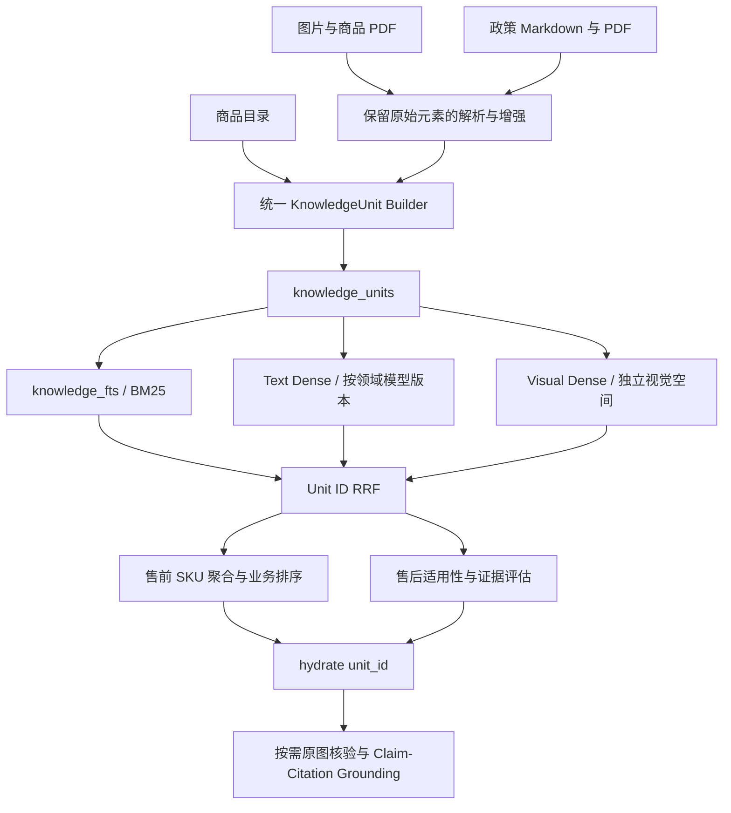

# Unified Knowledge Retrieval with Modality-Aware Indexing

当前证据决策与生成式模型基础设施已进一步升级，见[统一证据报告](unified-evidence.md)和[源码调用链](unified-evidence-call-chains.md)。以下知识层说明及历史测量保留其阶段语境。

实施日期：2026-11-23。审查基线：GitHub main 的 `a18faa1`。本次默认运行路径已切换到统一知识检索。

完整面试阅读指南见 [端到端代码调用链](unified-knowledge-call-chains.md)。实际测量见 [Benchmark JSON](unified-knowledge-benchmark.json)、[Shadow JSON](unified-knowledge-shadow.json)、[迁移与测试 JSON](unified-knowledge-validation.json)。

## 1. 重构前后

旧售前在 SKU 粒度检索 product_fts / product_vectors，在 Chunk 粒度检索 asset_fts / asset_vectors，资产结果先映射 SKU，再把 fts、dense、asset_bm25、asset_text、asset_visual、popular、personal 一起融合。商品字段和图片描述属于同一业务知识域，却有独立文本语料、查询编码及索引更新逻辑。

旧售后已经共用 Policy Retrieval，但 Markdown 直接产生 policy_chunks，PDF 同时保留 asset_chunks 和 policy_chunks 投影。资产证据加载和政策 Chunk 读取还依赖不同表。

现在每份检索单元只有一个 knowledge_units 规范记录。商品字段、商品资产进入 product 域；Markdown、政策 PDF 进入 policy 域。两域共用实现，各自执行业务过滤。查询来源格式不决定 Retriever。



保留 LangGraph、商品数据库、业务排序、个性化、多样性、政策适用性、Adaptive Retrieval 和 Faithfulness。没有新增微服务或第二个 Agent。

## 2. 知识模型与唯一事实源

| 层 | 实际存储 | 用途 |
|---|---|---|
| 商品业务事实 | products、product_commerce | 当前价格、库存、品牌、SKU、可见性及目录字段 |
| 政策业务事实 | policy_documents | 文档身份、版本、生效区间、适用范围、权威性 |
| 原始资产 | assets + 本地内容寻址 Asset Store | 图片、PDF、派生页图与裁剪图；SQLite 不保存图片 Base64 |
| 原始解析元素 | asset_elements | 原文、页码、坐标、阅读顺序、表格单元格、OCR 与模型观察来源 |
| 知识来源 | knowledge_sources | product/policy 领域与 SKU/doc_id；catalog/markdown/pdf/image 格式；资产、版本和 Hash |
| 规范检索单元 | knowledge_units | search_text、evidence_text、模态、结构数据、字段路径、页码/偏移、版本和 Hash |
| 元素关系 | knowledge_unit_elements | Unit 与多个原始 Element 的多对多证据关联 |
| 可选上下文 | knowledge_contexts | 原 Markdown Parent 文本；不建向量、不参与召回投票 |
| 派生文本索引 | knowledge_fts | 一张 FTS5 表，按领域、业务条件过滤 |
| 派生向量 | knowledge_vectors | Unit + text/visual 复合主键，模型版本、维度、内容 Hash、float32 BLOB |
| 增量与发布状态 | knowledge_dirty、knowledge_index_state | 商品变更队列、Generation、远端同步租约和成功版本 |

KnowledgeUnit 是检索单位。Asset 是文件资源。Element 是带位置的原始解析结果。Markdown 可以直接引用 source_id、章节和文本偏移，不会为了统一创建图片 Asset。商品 Profile 引用 products.title / products.attributes 等真实字段。

SQLite 的外键与 CHECK 约束强制 product 域关联 SKU、policy 域关联 doc_id。触发器校验 Asset 归属、Unit 元素所属来源及上下文元素归属；已索引资产不能直接改到另一个所有者。删除商品、政策或资产会级联清理来源、Unit、元素关系、本地向量及 FTS。

`KnowledgeUnit` dataclass 和 Repository 位于 `RetailPilot/knowledge.py`；DDL 位于 `knowledge_schema.py`。必要的领域、归属、来源、模态、位置和索引版本都是可查询字段，结构单元格与有限扩展元数据使用 JSON。

## 3. Ingestion 的实际实现

### 商品字段

`catalog_adapters.upsert_product()` 使用 UPSERT 更新 products，避免 REPLACE 删除旧商品后连带删除资产。商品触发器写入 knowledge_dirty。`sync_products()` 从当前原始字段构建 Profile，使用公共文本窗口函数切分，生成稳定的 `profile:{sku}:{ordinal}`。

标题、品牌、类目、标签、Features、Attributes、描述都进入 search_text。字段引用进入 field_refs。Profile 的结构化证据在 Hydration 时读取当前商品库，不再复制整份商品 JSON。只有发生内容变化的 Unit 才删除重建派生索引；未变化的图片 Unit 不受商品描述更新影响。

### 图片和商品说明书

`stage_asset()` 以所有者、素材类型和 source_key 得到稳定 Asset ID；原文件按 SHA-256 去重。图片替换沿用 Asset ID，revision 变化使旧证据失效。

`process_asset()` 取得处理租约，复用解析缓存，调用现有 Parser / OCR / VLM。详情长图保留区域图及原图关系；PDF 保留 Element、页码、bbox、章节、阅读顺序及预览。

公共 `build_chunks()` 直接为各模态输出 Unit 所需的数据。处理成功时，在同一数据库事务中发布 asset_elements、knowledge_sources、knowledge_units、元素关系和 FTS。不存在先写 asset_chunks 再复制 policy_chunks 的步骤。神经文本和视觉向量通过统一 build() 做可重试的后续派生构建。

图片的 evidence_text 保存 OCR 原文；模型 Caption、观察和商家宣传标签保留在元素元数据与 search_text。VLM 描述用于召回，不自动成为权威商品字段。

### Markdown 与政策 PDF

`ingest_policy_documents()` 保存政策身份和适用性元数据，再调用 `write_markdown()`。旧的 Section-Aware 窗口及 Chunk ID 被保留；窗口转成统一 DocumentElement，并使用公共 Builder 输出 KnowledgeUnit。原 Parent 只进入 knowledge_contexts，当前回答使用命中叶子证据，避免重复召回及扩大证据边界。

政策 PDF 先注册 policy_documents 元数据，再由 process_asset() 解析并写入同样的知识表。两种格式进入同一个 Policy BM25 和 Text Dense，没有按扩展名区分的在线召回分支。

### 表格

表格优先保存真实单元格、表头、行列位置和跨度关系。每 8 行切一个片段，复制对应表头，形成结构化 structured_data 和可检索 search_text。原页图或表格截图保留在 Asset Store。数值回答优先引用单元格，截图作为歧义复核和来源预览。

表格原始解析数据与检索分段有不同职责；不再额外保留另一套功能相同的 Chunk 表。

## 4. 保留和移除的索引

已移除运行代码及迁移后的物理表：

- product_fts、product_vectors。
- asset_fts、asset_vectors、asset_chunks、asset_chunk_elements、asset_vector_state。
- policy_chunks、policy_chunk_fts。
- 独立 Asset Text Encoder、SKU 向量文件加载流程、导入时未被使用的旧 SKU Hash 计算、旧 Policy Qdrant Retriever。
- asset_retrieval.py、asset_qdrant.py、旧 embeddings.py。
- PDF 向 policy_chunks 投影、启动时重建旧 FTS 等同步逻辑。

保留一个 knowledge_fts、一个规范向量表。文本向量按 product/policy 隔离，视觉向量保留独立空间。可选 Qdrant 按领域、space、模型版本建立镜像，Point ID 由 unit_id 确定；Payload 只有来源 ID 和版本，不保存文件内容。

现有远端旧 Collection 不会自动被删除；本次环境未配置远端服务，也没有对未知远端数据执行清理。它们已不参与新查询。确认备份和回滚窗口结束后，可由管理员清理旧集合和 data/embeddings 目录。

## 5. 检索、RRF 与业务排序

`knowledge_retrieval.py` 的三个 Retriever 都接收 RetrievalQuery / RetrievalFilters，返回 RetrievalHit(unit_id, route, score, rank, metadata)。

1. BM25 对同领域全部 Unit 查询一次。FTS 列权重为 identity=10、title=5、brand=3、category=2、body=1。精确 SKU 在 LIMIT 前优先。
2. Text Dense 只读取当前领域、当前模型版本、当前内容 Hash 的向量；查询文本只使用该领域对应编码器。不会把旧目录模型和图片描述模型混算。
3. Visual Dense 对 Image Unit 使用对应图文模型；支持文字查询和图片 bytes 查询。文本编码与图像编码来自同一个 SigLIP2，视觉向量独立于普通文本向量。
4. 各方法先执行业务 SQL 过滤，融合前再次回查有效 Unit，阻止过期 Dense 候选绕过过滤。
5. RRF 使用 unit_id，k=60，方法等权。每个方法内的同一 Unit 最多投一票，原始分数不直接相加。可选 CrossEncoder 重排证据相关性。
6. 售前再按 SKU 聚合，保留 Top-N 独立证据。最佳 Unit 分数加最高 10% 的有限证据奖励，重复内容 Hash 只占一个槽位。
7. 热门和个性化进入现有商品业务排序，不参与 Unit RRF；明确“热门推荐、随便看看”保留独立业务候选入口，直接跳过语义召回。

保留原来的 Candidate Policy、受控属性放宽、相关性门槛和多样性。只有软条件可以受控放宽。价格、品牌、类目、库存、排除条件和商品真实性继续由业务数据库控制。

Query Guard 区分 structured、text、visual 三类 Anchor。缺少 Caption/OCR 的纯视觉候选必须在视觉相似度门槛后，对 Top 证据原图完成查询相关核验；失败时不通过 Guard。不会要求视觉候选必须出现文字关键词。VLM 不可用时该类候选安全拒绝，已有文字证据的商品仍可检索。

视觉阈值默认 0.12，是待真实模型校准的配置值。本次只验证工程行为，没有据此声称真实模型已完成阈值标定。

## 6. 售后适用性与证据边界

Policy Retrieval 在公共检索之前落实 Topic Compatibility、Platform、Jurisdiction、Audience、Category Scope、Effective Date、Status、Version、Authority。PDF 资产的 source_version 还必须与 policy_documents.version 一致。

Markdown 和 PDF 统一得到 unit_id；旧 chunk_id 在 API 中作为同值兼容字段。Reranker 之后 hydrate(unit_id) 加载证据，再交给原 Evidence Assessment、Adaptive Follow-up 和 Faithfulness。next_action 语义不变，用户缺少信息与知识库缺证据仍然区分。

政策权益、期限和金额不能由 Caption 或视觉近邻推出。流程分支可以在原图核验后成为图示观察；保修、退款等权利结论继续依赖权威原文或真实结构化表格。

## 7. Evidence Hydration 与 Grounding

`knowledge_evidence.hydrate(unit_id)` 是唯一加载入口：

- Catalog：原字段引用与当前商品数据。
- Markdown：原段落、章节、偏移、文档版本。
- PDF Text：Element 原文、页码、bbox。
- Table：结构化单元格、表头、页面位置与截图。
- Image：原图/区域图的受保护预览地址、OCR 和观察来源。

EvidencePackage 增加 unit_id、source_id、field_refs，保留 chunk_id 等旧 API 字段。调用方无需知道旧表名。Asset API 保留授权、CSRF、策展权限、大小/页数限制和受保护预览；浏览器只收到 API 地址。

普通 LLM 接收经裁剪的事实与证据。视觉 Provider 由 asset_parsing.VisionProvider.invoke() 读取真实图片 bytes，构造 image_url / data:image/png;base64 消息；不会把本地文件路径当作图片传入模型。Base64 只存在于请求消息，不落数据库或 Qdrant。

Grounding 继续校验商品字段值、政策文档版本及适用性、原文引用、数值和单位。Asset Claim 还检查真实检索集合、Unit/Asset/Element 归属、版本、位置及内容支持。仅存在 Asset ID 不足以支持视觉结论。纯图示结论要求实际图片核验，失败返回缺证据。

## 8. 增量索引和一致性

- Unit、Source 都保存内容 Hash；稳定 ID 与来源关系保留。
- 更新 Unit 会事务性清理原 FTS 和本地向量，旧内容不会继续召回。
- Neural Embedding 批量 16 条构建；写回前检查内容 Hash，防止并发更新把旧向量写入新 Unit。
- 模型名、revision、领域、索引格式都进入 model_version；不同版本向量不可混算。build() 只重建缺失或变化的向量，可 force 重建。
- Qdrant 同步以 Generation + 租约 + CAS 发布。只有本地 Generation 与成功远端版本一致时才查询镜像；失败、过期或服务不可用时改用本地同版本向量。
- SQL 权威过滤得到的允许 Unit 集合再限制 Qdrant；超过 5,000 个允许 ID 时使用本地扫描。当前实现适合项目规模，尚未完成大型目录 ANN 性能评估。
- check 命令检查外键、FTS 缺失/孤立/重复、政策版本、向量 Hash 和远端同步状态。切换模型后仍需运行 build 及 sync。

删除本地资产会让远端镜像立即失去可用 Generation；下次 sync 清理当前模型集合中的无效 Point。旧模型集合按版本隔离，不再被查询。

## 9. 配置与可执行命令

新增统一配置：

| 环境变量 | 作用 |
|---|---|
| RETAILPILOT_KNOWLEDGE_PRODUCT_MODEL / REVISION | 商品 Profile 和资产文本共用模型/版本 |
| RETAILPILOT_KNOWLEDGE_POLICY_MODEL / REVISION | Markdown 和 PDF 共用模型/版本 |
| RETAILPILOT_KNOWLEDGE_QDRANT_URL / KEY | 可选统一向量镜像 |
| RETAILPILOT_MM_ENABLED | 多模态处理与资产知识开关，Catalog/Markdown 仍走统一文本链 |
| RETAILPILOT_MM_VISUAL_ENABLED | 独立视觉路线开关 |
| RETAILPILOT_MM_VISUAL_MODEL / REVISION | SigLIP2 图文空间 |
| RETAILPILOT_MM_PARSER / OCR / VLM_* | 原有真实 Docling、Tesseract 与视觉 API |
| RETAILPILOT_MM_CONTEXT_TOKENS / EVIDENCE_PER_SKU / VERIFY_* | 上下文、证据数量与核验预算 |

`hash` 是明确的离线测试模式，`disabled` 禁用 Dense。生产使用可用的 Sentence Transformers 文本模型并固定 revision；当前默认示例不宣称 Hash 有语义检索质量。原 MM_TEXT_MODEL 和 MM_QDRANT_* 配置已移除。旧 POLICY_QDRANT_* 配置不再使用；改用 KNOWLEDGE_QDRANT_*。旧商品索引目录配置仅保留读取兼容，不再生成或读取旧索引文件。

以下命令在仓库根目录运行；尖括号参数替换成现有 SKU/文件，不代表仓库自带这些业务素材。

```text
python -m pip install -r requirements.txt -r requirements-multimodal.txt
python scripts/knowledge.py migrate --backup data/before-unified.db
python scripts/assets.py import --sku <SKU> --type product_poster --path <image.png>
python scripts/assets.py import --sku <SKU> --type product_document --path <manual.pdf>
python scripts/assets.py register-policy <metadata.json> --markdown <policy.md>
python scripts/assets.py import --doc-id <DOC> --type document_page --path <policy.pdf> --source-version <VERSION>
python scripts/knowledge.py build --domain all --space text
python scripts/knowledge.py build --domain product --space visual
python scripts/knowledge.py check
python scripts/knowledge.py sync
python scripts/knowledge.py query "绿色背包 水杯侧袋" --domain product
python scripts/knowledge.py query "保修期限" --domain policy --topic 保修
python scripts/assets.py search "" --image <query.png>
python scripts/multimodal_bench.py --output benchmark.json
python -m pytest
npm test
python -m uvicorn RetailPilot.api:app --host 127.0.0.1 --port 8000
```

首次使用已有库必须先 migrate --backup，再启动新版服务，避免自动初始化提前执行迁移。空库可先运行 scripts/bootstrap_ci.py 生成合成目录。重型模型按需安装 requirements-multimodal-models.txt。增量再次执行 build；模型/解析变更时使用 --force 或 assets.py build --all。

旧 scripts/build_embeddings.py、build_policy_index.py 保留为新统一 build 的小型命令入口，旧 --model、--prune 等参数已移除；模型由环境变量选择，远端清理随 knowledge.py sync 执行。

### Shadow 与回滚

Shadow 使用 Git 基线代码和两份数据库快照，分别执行搜索，不会向用户发两次回答，也不会写入生产行为库。需要本地存在基线 Git 对象，并创建 .test-tmp 目录：

```text
python scripts/shadow_knowledge.py --baseline-ref a18faa1 --baseline-db data/before-unified.db --current-db data/ecommerce.db --queries queries.json --output shadow.json
python scripts/knowledge.py restore --backup data/before-unified.db --output data/rollback-unified.db
```

queries.json 是 JSON 数组，例如 `[{"domain":"product","query":"wireless headphone","category":"Electronics","target_terms":["headphone"]},{"domain":"policy","query":"保修凭证","topic":"保修"}]`。

迁移在事务内从原始商品、旧 Chunk 与元素重建规范 Unit；保留旧 Policy/Asset Chunk ID。PDF 的旧 Policy 投影不会再生成第二个 Unit。成功后移除冗余表。完整 SQLite 在线备份是回滚依据，restore 只写到一个不存在的新路径，不覆盖当前数据库。

生产回滚需要同时切换代码到 `a18faa1` 和 RETAILPILOT_DB_PATH 到恢复文件，并重启服务。仅修改数据库路径无法让旧代码读取新表结构。Asset Store 和备份应一起保留。发布维护窗口内暂停写入；回滚后新增业务数据需要人工或增量补偿，快照回滚不是跨版本写入合并。

本地已执行实际迁移，4,203 个商品与 6 份政策逐字段一致，生成 4,209 个 Unit；旧库没有资产，因此资产迁移另用真实旧 Schema fixture 覆盖。恢复演练读回 4,203 商品与 6 个旧 policy_chunks。

## 10. 已执行的测试和测量

全量 pytest：**262 passed / 6 failed**。重构前：253 passed / 6 failed。新增失败为 0。前端：8 passed。迁移、Unit Fusion、视觉缺 Caption/OCR、模型版本更新、原图 bytes、Qdrant 内存实例、政策适用性、Adaptive Retrieval、Faithfulness 和 API 授权均有实际测试。

历史失败保持原断言：

- tests/test_api.py::test_api_smoke
- tests/test_evaluation_pipeline.py::test_low_candidate_policy_relaxes_before_zero_results
- tests/test_evaluation_pipeline.py::test_search_logging_persists_routes_impressions_and_sample
- tests/test_retrieval.py::test_hybrid_search_respects_budget_and_negative_brand
- tests/test_retrieval.py::test_search_uses_controlled_attribute_relaxation_when_strict_pool_is_empty
- tests/test_retrieval.py::test_approximate_budget_keeps_nearby_exact_catalog_match

这些目录夹具/候选断言在基线已失败，未删除、跳过或放宽。旧私有 Retriever/表结构测试更新为新 Unit 合约；Policy RRF 测试仍验证不同原始分数尺度不能直接相加。另修复工具全局 Deadline 毫秒取整触发额外重试的问题，原超时断言未放宽。迁移 SQL Fixture 固化自 a18faa1，浅克隆 CI 不需要 Git 历史。pytest 临时目录改为仓库相对路径。

11 条合成样本，K=3。Stub OCR/VLM/视觉编码器，文本使用 Hash；真实模型标记为 false。Answer Correctness 是确定性证据答案校验，不是 LLM Judge 结果。

| 配置 | SKU Recall@3（5题） | Unit/Evidence Recall@3（9题） | Answer Correctness（11题） | P50/P95 ms |
|---|---:|---:|---:|---:|
| 旧架构 Full Multimodal | 1.000 | Unit 未测；Asset 1.000 | 1.000 | 21.042 / 37.851 |
| Unified | 1.000 | 1.000 | 1.000 | 30.553 / 57.279 |
| BM25 Only | 0.800 | 0.889 | 0.909 | 24.787 / 34.949 |
| Dense Only | 0.800 | 0.778 | 0.818 | 20.699 / 34.794 |
| BM25 + Dense | 0.800 | 0.889 | 0.909 | 27.222 / 42.703 |
| BM25 + Dense + Visual | 1.000 | 1.000 | 1.000 | 32.023 / 47.873 |
| Visual Disabled | 0.800 | 0.889 | 0.909 | 26.305 / 39.052 |
| Product Profile Only | 0.400 | 0.556 | 0.636 | 27.430 / 32.511 |
| Asset Knowledge Only | 0.800 | 1.000 | 0.909 | 41.661 / 58.594 |

MRR/nDCG、逐题记录、Citation Accuracy、适用性 Probe、构建时间和存储数据均在 JSON。Unified 与 Full 配置下 SKU/Unit MRR、nDCG 均为 1；新配置 9 个 Citation 全部通过，独立政策适用性 Probe 9/9。BM25 与 Dense 消融无法召回无 OCR/Caption 的外观样本；加入 Visual 后可以。

旧 Full SQLite 文件 520,192 bytes，新 Unified 503,808 bytes；索引逻辑 Payload 分别 5,389 / 20,961 bytes。新夹具额外构建了商品 Profile 和政策文本向量，不能将 Payload 变化解读为同工作量存储优化。当前 4,203 商品本地库从 15,695,872 增至 35,430,400 bytes，也受新增派生索引和 SQLite 空闲页影响。没有执行压缩，也不声称整体磁盘占用下降。

新 Unified 首次 Ingestion/Build 867.198 ms，强制 Embedding 重建 19.924 ms；另一个等价 Full 运行分别 549.564 / 19.566 ms，含缓存热身差异。外部调用和费用为 0。旧运行没有构建时间记录，因此不编造对比值。

Shadow 对本地 5 个查询运行旧/新代码：两条政策 Evidence ID 一致；引用增加 Unit/Source 信息，逐字 JSON 不一致。两条商品查询排名变化，主要归因于撤出 popular/personal 的 RRF 票、同一 Unit 语料与确定性同分排序；没有标注集证明哪组业务排名更好。热门推荐入口的新路径返回候选，旧规则路径返回空。

Shadow 商品两条耗时为 52.731→91.623 ms、34.956→83.705 ms；热门请求 4.528→334.799 ms。政策 2.313→10.775 ms、2.182→10.627 ms。单次测量不是生产 P95。本次增加的 Hydration 和 SQL 复查有成本，架构统一没有自动带来延迟改善。

## 11. 主要代码文件

新增 knowledge_schema.py、knowledge.py、knowledge_index.py、knowledge_retrieval.py、knowledge_qdrant.py、knowledge_evidence.py；新增 scripts/knowledge.py、shadow_knowledge.py；新增 Knowledge 测试、旧 Schema Fixture 和三份测量 JSON。

修改 database.py、catalog_adapters.py、asset_schema.py、asset_ingestion.py、asset_embeddings.py、asset_evidence.py、retrieval.py、policy_ingestion.py、policy.py、policy_index.py、grounding.py、graphs/pre_sales.py、tools.py、API 可选字段、前端路线标签与构建脚本。删除旧 embeddings.py、asset_retrieval.py、asset_qdrant.py。完整变更以 PR Diff 为准。

## 12. 已知边界

真实 SigLIP2 / 神经文本模型召回质量、视觉阈值标定、完整 Docling 扫描 PDF 模型以及真实 OCR/VLM Endpoint 质量未在本机验证。接口是真实模型接口，测试中的合成输出不会作为模型能力验收。

本地向量回退是 SQL 过滤后的精确扫描。Qdrant 内存实例已测试，远端部署、网络故障压力和大规模 ANN 性能尚未验证。旧远端模型 Collection 的物理回收需要运维确认。

视觉 Guard 对缺少文字证据的候选要求原图核验，VLM 缺失会降低这类商品召回；这是明确降级。当前 Guard 使用文本观察结果，不是经过真实标注集校准的视觉判断器。

基线 6 项失败尚未解决，不能声称整个仓库测试全绿或 CI 质量门槛已经通过。已提供可复现命令及真实差异；下一步应使用真实目录标注、固定模型 revision、多次热身/重复采样测量来校准质量与延迟。
